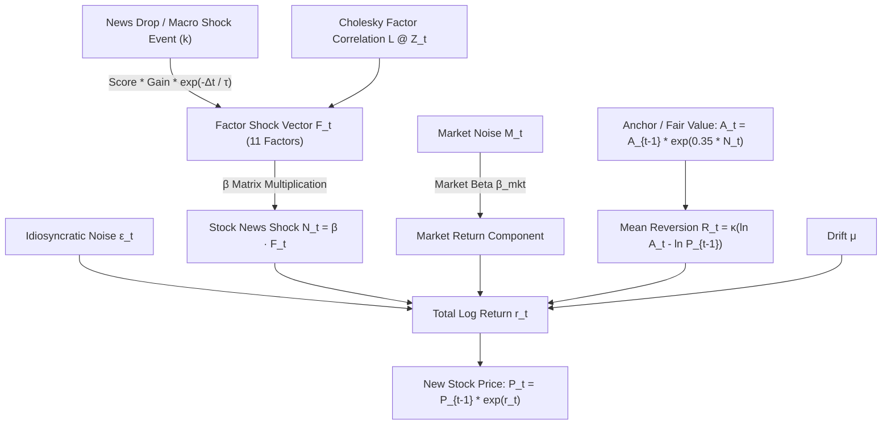
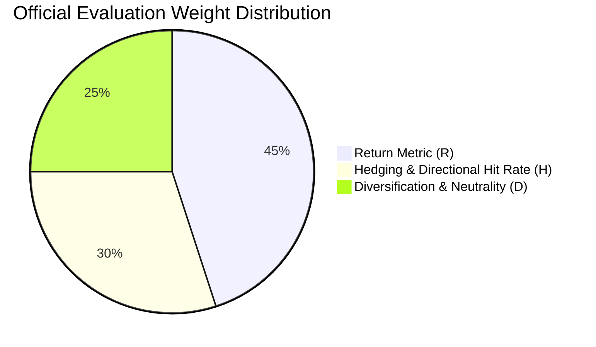

# Chakravyuh - Nivesh Chakra (Stock Market Simulation)

An institutional-grade, multi-factor real-time stock market trading simulation and competition platform.

> **Context & Origin**: This platform was created specifically for the **Chakravyuh** flagship event. It enables administrators and judges to run a live, interactive market simulation where student teams analyze news headlines, factor shocks, and equity sensitivities to trade in real-time.

---

## 🌐 Live Deployments

The platform is deployed live and fully functional on Netlify:
* **Student Trading Portal**: [https://dpsstockmarket.netlify.app](https://dpsstockmarket.netlify.app)
* **Judge / Admin Console**: [https://dpsstockmarket.netlify.app/admin.html](https://dpsstockmarket.netlify.app/admin.html)
  * **Admin Password**: `judge123`

---

## 📁 Project Documentation & Specifications (PRD)

All initial specifications, UI wireframes, and developer handovers are archived in the [`PRD/`](file:///home/adityapokuri/Documents/DEVELOPMENT/Stock%20Market/stock-market/PRD) folder:
* **`PRD/Chakravyuh Trading Game - Developer Handover (v5).docx`**: Base developer handoff detailing the stochastic engine, tick scaling, and news matrix architecture.
* **`PRD/Chakravyuh - Nivesh Chakra - Developer Handover.pdf`**: Equities universe, factor definitions, starting financials, and event rules.
* **`PRD/Chakravyuh Judge Console - Full Implementation Handover (v2).pdf`**: Quantitative scoring algorithms, administrative protocols, and blotter replay specifications.
* **`PRD/UI Schem 1.jpeg`, `2.jpeg`, `3.jpeg`**: UI schematics and visual layouts.

*(See the dedicated [Comprehensive Quantitative & Economics Architecture](#-comprehensive-quantitative--economics-architecture) section at the end of this document for full mathematical formulations, factor matrices, and scoring algorithms).*

---

## 🚀 Features & Architecture

* **Student Trading Terminal (`index.html` / `app.js`)**:
  * Real-time tick-by-tick charts (Line and Candlestick modes).
  * Live ticker tape and breaking news feed with synthesized Web Audio alert chimes.
  * Instant order entry (Market & Limit orders, Long positions, and Short selling).
  * Real-time portfolio valuation, cash balance, P&L, and trade execution blotter.
  * Stock Research modal detailing business models, headquarters, and supply chain footprints.
  * Offline fallback mode (auto-generates bundle `.json` download for manual submission).

* **Judge & Admin Console (`admin.html` / `admin.js`)**:
  * **Event Management**: Control game phases across sessions (Waiting Room, 5-minute Portfolio Building phase, Session 1, and Session 2).
  * **Dynamic Team Management**: Register and configure user teams with custom passwords and unique starting capital directly from the admin panel during each session.
  * **Real-time Live Leaderboard**: Synchronized evaluation of team equity curves and rankings.
  * **Quantitative Evaluation & Radar Charts**: Multi-factor performance analysis across Return ($R$), Diversification ($D$), and Factor Hedging ($H$).
  * **Auditing & Export**: Inspection of round-trip trade executions and one-click export to CSV.

* **Market Engine (`market_engine.py`)**:
  * Simulates 12 equities across 11 macroeconomic factors.
  * Deterministic reproduction via seeds (`python market_engine.py <seed>`).

---

## 🛠️ Running Locally

Because modern web browsers enforce CORS restrictions on local `file:///` requests for JSON data and ES modules, run the project with any local HTTP server:

```bash
# Using Python
python -m http.server 8000
```

Then open in your browser:
* **Student Trading Portal**: [http://localhost:8000/index.html](http://localhost:8000/index.html)
* **Judge / Admin Console**: [http://localhost:8000/admin.html](http://localhost:8000/admin.html)

---

## 👨‍⚖️ How to Run the Event via the Admin Panel

1. **Log in to Admin Console**:
   * Navigate to [`https://dpsstockmarket.netlify.app/admin.html`](https://dpsstockmarket.netlify.app/admin.html) (or `http://localhost:8000/admin.html` locally).
   * Enter the admin passkey: **`judge123`**.

2. **Register Teams & Set Capital**:
   * Under **Team Management**, enter the Team Name, Password, and Starting Capital (e.g., ₹10,00,000).
   * Click **Add Team**. Teams can now log into their student trading terminals using their assigned credentials.

3. **Phase Progression**:
   * **Start Event / Portfolio Building**: Puts all teams into the 5-minute portfolio preparation countdown where students analyze equities and establish initial holdings.
   * **Start Round 1 / Round 2**: Initiates the live market ticks (20 minutes / 1,200 ticks per session).
   * **Pause / Resume**: Temporarily freeze the market clock if announcements or interventions are needed.

4. **Scoring & Exporting**:
   * Tune scoring weights ($R$, $D$, $H$) live on the dashboard.
   * Click **Export CSV** at the end of the competition for final standings and detailed metrics.

---

## 📈 Comprehensive Quantitative & Economics Architecture

The economic model is driven by an Euler-Maruyama discretized jump-diffusion model with Ornstein-Uhlenbeck mean reversion, multi-factor cross-correlations, and decay shocks.

### 1. Market Engine Pipeline



---

### 2. Mathematical Price Formulation

For every stock $i$ at discrete time tick $t$, the log return $r_{i,t} = \ln(P_{i,t} / P_{i,t-1})$ is formulated as:

$$r_{i,t} = \mu \cdot \Delta t + \beta_{i}^{\text{mkt}} M_t + N_{i,t} + R_{i,t} + \epsilon_{i,t}$$

Where:

| Term | Symbol | Formula / Description | Calibration Value |
| :--- | :---: | :--- | :--- |
| **Drift** | $\mu \cdot \Delta t$ | Constant positive upward baseline drift | $6.2 \times 10^{-5} \times 0.1$ |
| **Market Return** | $M_t$ | Systemic market-wide fluctuation: $\sigma_{\text{mkt}} Z_t^{\text{mkt}}$ | $\sigma_{\text{mkt}} = 0.004 \times \sqrt{0.1}$ |
| **News / Factor Shock** | $N_{i,t}$ | Sensitivity to macro factor shocks: $\sum_{k=1}^{11} \beta_{i,k} F_{k,t}$ | Dynamically evaluated |
| **Mean Reversion** | $R_{i,t}$ | Ornstein-Uhlenbeck pull back to fair value: $\kappa (\ln A_{i,t} - \ln P_{i,t-1})$ | $\kappa = 0.08 \times 0.1 = 0.008$ |
| **Fair Value Anchor** | $A_{i,t}$ | Permanent jump updating: $A_{i,t} = A_{i,t-1} \cdot \exp(0.35 \cdot N_{i,t})$ | 35% permanent shock |
| **Idiosyncratic Noise** | $\epsilon_{i,t}$ | Uncorrelated individual firm noise: $1.6 \cdot \sigma_{i}^{\text{idio}} Z_{i,t}$ | Stock specific ($\sim 0.003 - 0.010$) |

#### Price Update Equation:
$$P_{i,t} = P_{i,t-1} \cdot \exp(r_{i,t})$$
This exponential log-return formulation mathematically guarantees that $P_{i,t} > 0$ for all ticks.

---

### 3. Factor Dynamics & News Decay

The 11 macro factors vector $F_t \in \mathbb{R}^{11}$ at tick $t$ is composed of correlated stochastic volatility plus exponentially decaying news shocks:

$$F_t = (L \cdot Z_t) \odot \sigma_F + \sum_{e \in \text{Events}} S_e \cdot g_e \cdot \exp\left(-\frac{t - t_e}{\tau_e}\right) \cdot \left(\frac{\tau_{\text{ref}}}{\tau_e}\right)$$

* $L$: Lower triangular Cholesky decomposition of the $11 \times 11$ factor correlation matrix $\mathbf{C}$ ($L L^T = \mathbf{C}$).
* $S_e \in [-1, 1]$: Realized severity score of news event $e$.
* $g_e$: Event impact gain ($0.05 \times \text{gain scale}$).
* $\tau_e$: Exponential half-life decay rate (typically 5 minutes = 300 ticks).
* $\tau_{\text{ref}}$: Reference normalization horizon (360 ticks).

---

### 4. Tradeables Universe & Factor Sensitivity ($\beta$) Matrix

| Ticker | Asset Class | Base Price (₹) | Market $\beta$ | Primary Macro Sensitivities ($\beta_{i,k}$) |
| :--- | :--- | :---: | :---: | :--- |
| **TSMC** | Equity | ₹7,168.31 | 1.40 | SemiconductorDemand: `+0.85`, GeopoliticalStability: `+0.30`, RegulatoryRisk: `-0.30` |
| **FERRARI** | Equity | ₹35,942.28 | 0.96 | ConsumerDisc: `+0.40`, InterestRates: `-0.12`, Oil: `-0.09` |
| **LMT** | Equity | ₹49,878.82 | 0.22 | Aero: `+0.75`, GeopoliticalStability: `-0.40`, TechDevelopments: `-0.15` |
| **HDFC** | Equity | ₹824.50 | 0.66 | InterestRates: `-0.25`, RegulatoryRisk: `-0.20`, Oil: `-0.12`, ConsumerDisc: `+0.10` |
| **PFE** | Equity | ₹2,304.14 | 0.40 | Healthcare: `+0.75`, RegulatoryRisk: `-0.35` |
| **RELIANCE** | Equity | ₹1,310.00 | 0.50 | Oil: `+0.30`, InflationReaction: `+0.30`, InterestRates: `-0.20`, ConsumerDisc: `+0.20` |
| **DKNG** | Equity | ₹2,524.35 | 1.60 | ConsumerDisc: `+0.45`, RegulatoryRisk: `-0.40`, TechDevelopments: `+0.35` |
| **SPACEX** | Equity | ₹13,851.52 | 1.20 | Aero: `+0.75`, TechDevelopments: `+0.60`, InvestorConfidence: `+0.35`, RegRisk: `-0.25` |
| **SAMSUNG** | Equity | ₹18,123.06 | 0.50 | SemiconductorDemand: `+0.80`, InterestRates: `-0.30`, GeopoliticalStability: `+0.20` |
| **GOLD** | Commodity | ₹1,48,290.00 | 0.13 | InterestRates: `-0.50`, GeopoliticalStability: `-0.50`, InflationReaction: `+0.30` |
| **OIL** | Commodity | ₹6,807.55 | 0.10 | Oil: `+0.90`, GeopoliticalStability: `-0.30`, InflationReaction: `+0.10` |
| **LITHIUM** | Commodity | ₹2,179.26 | 1.03 | SemiconductorDemand: `+0.35`, TechDevelopments: `+0.25`, ConsumerDisc: `+0.20` |

---

### 5. Macro Factor Cross-Correlation Matrix ($\mathbf{C}$)

| Factor Pair | Correlation Coefficient ($r$) | Economic Rationalization |
| :--- | :---: | :--- |
| **InterestRates $\longleftrightarrow$ InflationReaction** | `+0.35` | Central bank rate hikes respond directly to elevated headline inflation prints. |
| **Oil $\longleftrightarrow$ InflationReaction** | `+0.30` | Energy input costs pass through into aggregate consumer price indices. |
| **SemiconductorDemand $\longleftrightarrow$ TechDevelopments** | `+0.35` | Compute infrastructure and AI advances drive fab volume demand. |
| **InvestorConfidence $\longleftrightarrow$ ConsumerDisc** | `+0.30` | Household optimism expands high-margin discretionary expenditures. |
| **GeopoliticalStability $\longleftrightarrow$ Oil** | `-0.25` | Geopolitical conflict disrupts trade routes and restricts crude supply. |
| **Aerospace $\longleftrightarrow$ GeopoliticalStability** | `-0.30` | Heightened defense contracting offsets civil airline declines during instability. |
| **InterestRates $\longleftrightarrow$ InvestorConfidence** | `-0.20` | Tightening monetary policy dampens risk asset multiples and liquidity. |

The correlation matrix $\mathbf{C}$ is repaired using positive semi-definite (PSD) eigenvalue clipping ($\min(\lambda_i, 10^{-6})$) to guarantee mathematical stability during Cholesky decomposition:

$$\mathbf{C}_{\text{PSD}} = \mathbf{V} \cdot \text{diag}(\max(\lambda_i, 10^{-6})) \cdot \mathbf{V}^T$$

Where $\text{diag}(...)$ constructs the diagonal matrix of clipped eigenvalues $\lambda_i \ge 10^{-6}$.

---

### 6. Quantitative Evaluation & Scoring Engine (`scoring.js`)

Teams are evaluated on a balanced quantitative scorecard combining three core pillars:



$$\text{Final Score} = \frac{w_R \cdot S_R + w_D \cdot S_D + w_H \cdot S_H}{w_R + w_D + w_H} \times 100$$
*(Default configuration: $w_R = 45$, $w_D = 25$, $w_H = 30$)*

#### A. Return Score ($S_R$)
Measures portfolio return against a sigmoid logistic curve centered at baseline return $r_0 = 4\%$:

$$S_R = \frac{1}{1 + \exp\left(-\frac{\bar{r} - r_0}{\lambda}\right)}$$

Where:
* $\lambda = 0.086$ when $\bar{r} \ge r_0$ (rewards high outperformance smoothly).
* $\lambda = 0.0289$ when $\bar{r} < r_0$ (sharply penalizes negative returns / capital depletion).

#### B. Diversification & Risk Score ($S_D$)
Combines Effective Factor Rank ($d_{\text{Rank}}$) and Portfolio Neutrality ($d_{\text{Neut}}$):

$$S_D = 0.6 \cdot d_{\text{Rank}} + 0.4 \cdot d_{\text{Neut}}$$

1. **Effective Factor Rank ($R_{\text{eff}}$)**: Measures the diversity of independent factor exposures using the Gram matrix $\mathbf{G} = \sum_t (\mathbf{w}_t \odot \boldsymbol{\beta})^T (\mathbf{w}_t \odot \boldsymbol{\beta})$:

$$R_{\text{eff}} = \frac{(\text{Tr}(\mathbf{G}))^2}{\|\mathbf{G}\|_F^2}, \quad d_{\text{Rank}} = \min\left(\frac{R_{\text{eff}}}{5.0}, 1.0\right)$$

*(Calculated directly from `scoring.js` as `Reff = (tr * tr) / fro2` where `fro2` is the squared Frobenius norm $\sum_{k,l} G_{k,l}^2$ and `tr` is $\sum_k G_{k,k}$)*.

2. **Factor Neutrality ($\nu$)**: Penalizes unhedged one-sided macro bets:

$$\nu = 1 - \frac{\sum_k |\sum_i w_i \beta_{i,k}|}{\sum_k \sum_i |w_i \beta_{i,k}|}, \quad d_{\text{Neut}} = \min\left(\frac{\nu}{0.70}, 1.0\right)$$

#### C. Macro Awareness & Hit Rate ($S_H$)
Measures trading precision on qualifying trades ($|\text{trade value}| \ge 0.5\% \cdot K_0$) with Bayesian Laplace smoothing ($\kappa = 2$):

$$S_H = \frac{\text{Hits} + \frac{\kappa}{2}}{N_{\text{Trades}} + \kappa} = \frac{\text{Hits} + 1}{N_{\text{Trades}} + 2}$$

Where a trade is classified as a **Hit** if:
* **Long position**: $P_{\text{exit}} > P_{\text{entry}}$
* **Short position**: $P_{\text{exit}} < P_{\text{entry}}$
